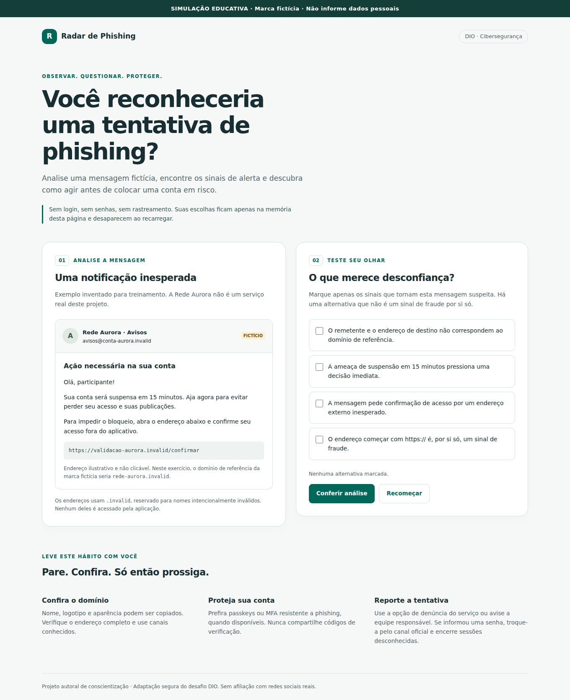

# Radar de Phishing — conscientização e análise de sinais

> **Adaptação educativa do desafio DIO.** Este projeto não clona o Facebook,
> não cria páginas de autenticação e não captura senhas. A demonstração usa
> uma marca fictícia e informa expressamente que se trata de treinamento.

## 1. Contexto do desafio

O enunciado original propõe estudar engenharia social com o Social-Engineer
Toolkit (SEToolkit), utilizando uma página falsa de uma rede social.
Este projeto transforma a atividade em um laboratório defensivo: analisar
uma mensagem fictícia, identificar indícios de phishing e justificar
medidas de proteção, sem colocar credenciais ou terceiros em risco.

**Esta entrega não reproduz integralmente a atividade prática original.**
Ela não demonstra execução do SEToolkit, clonagem de sites ou captura de
credenciais. A aceitação desta adaptação deve ser confirmada com a DIO ou
com o instrutor.

### Origem e melhorias deste fork

- **Repositório original:** [cassiano-dio/cibersecurity-desafio-phishing](https://github.com/cassiano-dio/cibersecurity-desafio-phishing).
- **Fork público confirmado:** [tduarte-eng/cibersecurity-desafio-phishing](https://github.com/tduarte-eng/cibersecurity-desafio-phishing).
- **Histórico preservado:** o commit original
  `02d47afbfbca9106bc20a1b6f20d925b2289ff61` permanece como ancestral.
- **Melhorias:** laboratório interativo autoral, interface responsiva,
  feedback explicativo, servidor local restrito, testes automatizados,
  captura real da aplicação e documentação de privacidade.
- **Integração contínua:** workflow de testes para Node.js 20, 22 e 24,
  com permissões somente de leitura e ações oficiais fixadas por commit.
- **Hospedagem em subpastas:** caminhos relativos permitem servir a interface
  em URLs de projeto, como as usadas pelo GitHub Pages.

O README atual substitui o roteiro operacional da versão original por esta
abordagem educativa. A captura original de credenciais não integra a árvore
atual; não é apresentada como evidência deste trabalho. O histórico de origem
não é apagado, e nenhuma alteração é enviada ao repositório do instrutor.

## 2. Objetivos de aprendizagem

- Reconhecer pressão por urgência, divergência de domínio e pedidos
  inesperados de confirmação de acesso.
- Diferenciar criptografia de transporte (HTTPS) de legitimidade de um site.
- Explicar conceitualmente o papel do SEToolkit em avaliações autorizadas.
- Documentar decisões técnicas, limites, testes e medidas defensivas.
- Preparar um projeto autoral para versionamento e exposição no GitHub.

## 3. SEToolkit: compreensão conceitual

O **Social-Engineer Toolkit**, mantido pela TrustedSec, reúne recursos de
engenharia social para testes de segurança. Seu uso em qualquer ambiente
depende de autorização explícita e de um escopo previamente definido.

Em termos conceituais, um ataque de phishing pode combinar:

1. **Pretexto:** uma situação que parece justificar a solicitação.
2. **Persuasão:** pressão por urgência, autoridade ou medo.
3. **Imitação:** elementos visuais que aparentam representar uma instituição.
4. **Indução à ação:** tentativa de fazer a pessoa revelar informações ou
   executar uma ação indevida.

Aqui, apenas os sinais de persuasão e de endereço são representados em um
exemplo claramente identificado. Não há instruções operacionais de
clonagem, coleta ou distribuição de páginas falsas.

## 4. Demonstração implementada

A aplicação **Radar de Phishing** apresenta uma mensagem da fictícia
**Rede Aurora**. O participante marca sinais de alerta e recebe explicações.



### Fluxo do exercício

1. Ler o aviso de simulação e a mensagem inventada.
2. Comparar remetente e destino com o domínio fictício de referência.
3. Selecionar os sinais suspeitos.
4. Clicar em **Conferir análise** para visualizar a avaliação e os trechos destacados.
5. Ler as explicações, alterar as escolhas ou clicar em **Recomeçar**.

### Critério de avaliação

São avaliadas quatro decisões:

| Alternativa | Decisão esperada | Justificativa |
| --- | --- | --- |
| Domínios diferentes do domínio de referência | Marcar | Semelhança de nome não comprova vínculo |
| Ameaça de suspensão em 15 minutos | Marcar | Pressiona uma decisão sem verificação |
| Confirmação inesperada por endereço externo | Marcar | Exige confirmação independente |
| HTTPS, por si só, é sinal de fraude | Não marcar | HTTPS não determina a legitimidade do domínio |

Cada decisão correta vale um ponto; a nota máxima é **4/4**. Uma alternativa
suspeita não marcada conta como erro; a alternativa sobre HTTPS corretamente
não marcada conta como acerto. Por isso, nenhuma seleção resulta em **1/4**,
e marcar tudo resulta em **3/4**.

Os sinais são indícios que devem motivar verificação: nenhum indício isolado
substitui uma análise de contexto.

## 5. Limites e privacidade

- Sem marca, logotipo ou tela de login de serviços reais.
- Sem campos de e-mail, usuário, senha, código MFA ou texto livre.
- Apenas caixas de seleção com valores fixos para as respostas.
- Sem API de coleta, banco de dados, cookies, analytics ou armazenamento local.
- Escolhas processadas no navegador e mantidas apenas na memória da página.
- Sem chamadas de rede originadas pelas escolhas do participante.
- Sem bibliotecas, fontes, imagens ou scripts de terceiros.
- Endereços fictícios usam `.invalid`, reservado para nomes
  intencionalmente inválidos, e não são links clicáveis.
- Política de conteúdo bloqueia conexões da aplicação e envio de formulários.
- Servidor de desenvolvimento vinculado apenas a `127.0.0.1`, sem acesso
  pela rede local por padrão.
- Servidor entrega somente uma lista explícita de arquivos públicos e
  rejeita métodos diferentes de `GET` e `HEAD`.

O navegador ainda faz requisições HTTP locais para carregar os arquivos da
aplicação. O servidor não implementa registro de acessos nem grava respostas.
Não se trata de uma garantia sobre registros mantidos pelo sistema operacional,
navegador ou infraestrutura externa caso alguém modifique a forma de hospedagem.

## 6. Tecnologias e decisões técnicas

| Tecnologia / decisão | Motivo |
| --- | --- |
| HTML semântico e `lang="pt-BR"` | Organização e leitura em português |
| CSS responsivo | Uso em telas pequenas e grandes |
| JavaScript nativo com módulos | Interatividade sem dependências |
| `textContent` e criação de nós DOM | Renderização sem interpretar respostas como HTML |
| Regras de avaliação em módulo separado | Testar pontuação independentemente da interface |
| Node.js e módulos nativos | Servidor local e testes sem instalação de pacotes |
| Alternativas fixas, sem texto livre | Não solicitar dados pessoais |
| Aviso explícito de simulação | Não induzir o participante a acreditar em um serviço real |

A interface inclui rótulos associados às caixas de seleção, foco visível,
atualização anunciada da quantidade selecionada, foco no resultado após
avaliação e alternativa textual quando o JavaScript está desativado.
Isso não equivale a uma certificação completa de acessibilidade.

## 7. Executar localmente

**Requisito:** Node.js 20 ou superior, com npm.
Não é necessário executar `npm install`: não existem dependências externas.

Na pasta do projeto:

```bash
npm start
```

Abra **http://127.0.0.1:4173** no navegador. Encerre com `Ctrl+C`.

Use o servidor local, não abra o HTML diretamente por `file://`: a aplicação
utiliza módulos JavaScript. Seus recursos usam caminhos relativos ao documento,
compatíveis tanto com a raiz de um servidor quanto com subpastas.
Se a porta 4173 estiver ocupada, encerre apenas uma instância anterior deste
projeto sob seu controle ou ajuste a porta em `server.js`. Não encerre
processos de outros usuários.

## 8. Testes e verificação

Execute:

```bash
npm test
```

Os testes automatizados verificam:

- Acerto completo com as três alternativas suspeitas.
- Penalização da seleção incorreta de HTTPS.
- Avaliação de respostas vazias e parciais.
- Rejeição explícita de alternativas desconhecidas.
- Entrega de HTML, CSS e módulos com tipos apropriados e suporte a `HEAD`.
- Resolução dos recursos dentro da subpasta do projeto, sem escapar para a raiz.
- Bloqueio de arquivos internos e caminhos fora da lista pública.
- Rejeição de tentativas de envio por `POST`.

Os testes do servidor abrem portas efêmeras apenas no endereço de loopback
e as encerram ao terminar.

### Verificação realizada nesta entrega

- **9 testes automatizados aprovados**, sem falhas, com `npm test`.
- Interface verificada em Chromium headless: notas **4/4**, **3/4**, **1/4**
  e **2/4**, reinício e limpeza das escolhas ao recarregar.
- Interação por teclado e ausência de rolagem horizontal nas larguras
  de **390 px** e **320 px**.
- Nenhuma requisição gerada ao responder ao exercício, nenhuma requisição
  externa e nenhum erro de JavaScript ou de política de conteúdo observados.
- Captura real da interface salva em `images/demonstracao.png`.

A checagem de navegador foi realizada com ferramenta temporária fora do
projeto; ela não adiciona Playwright às dependências nem faz parte de `npm test`.
O roteiro abaixo permite repetir manualmente as verificações de interface.

### Integração contínua no GitHub

O workflow [.github/workflows/tests.yml](.github/workflows/tests.yml) executa
`npm test` em pushes, pull requests ou acionamento manual, em uma matriz de
Node.js **20, 22 e 24**. Não instala dependências porque o projeto não possui
pacotes externos.

Confira a aba **Actions** do fork para verificar o resultado remoto. Se o
GitHub solicitar habilitação de workflows em forks, autorize pela própria
interface. A existência do arquivo de workflow não comprova que uma execução
remota foi concluída; a validação local registrada acima foi feita em Node.js 20.

### Roteiro de validação da interface

1. Marcar as três primeiras alternativas: esperar **4/4**.
2. Marcar também a alternativa sobre HTTPS: esperar **3/4**.
3. Clicar em **Recomeçar**: esperar nenhuma seleção e resultado oculto.
4. Conferir sem selecionar: esperar **1/4**, com explicações.
5. Alterar uma escolha após conferir: o resultado anterior deve desaparecer.
6. Usar teclado e uma tela estreita: verificar foco, rótulos e ausência de
   rolagem horizontal.
7. Na aba de rede do navegador, confirmar que responder ao exercício não
   envia requisições.

## 9. Estrutura

```text
.
├── .github/
│   └── workflows/
│       └── tests.yml       # Testes automáticos no GitHub
├── index.html              # Conteúdo e estrutura da demonstração
├── styles.css              # Layout responsivo e estados visuais
├── images/
│   └── demonstracao.png    # Captura real da interface
├── src/
│   ├── app.js              # Interações e apresentação dos resultados
│   └── scenarios.js        # Alternativas, explicações e avaliação
├── server.js               # Servidor estático restrito ao loopback
├── test/
│   ├── scenarios.test.js   # Casos de avaliação
│   └── server.test.js      # Entrega de arquivos e limites do servidor
├── package.json            # Comandos de execução e testes
├── .gitignore
└── README.md
```

## 10. Medidas defensivas e resposta a incidentes

- Verificar o domínio completo, não apenas o nome exibido ou a aparência.
- Não usar o endereço da mensagem para verificar a própria mensagem.
- Abrir o aplicativo oficial ou um endereço previamente conhecido.
- Preferir passkeys ou MFA resistente a phishing, quando disponíveis.
  Outros tipos de MFA também ajudam, mas códigos podem ser solicitados em golpes.
- Utilizar gerenciador de senhas; a ausência de preenchimento no domínio
  esperado pode ser um alerta, mas não é prova definitiva.
- Manter navegador e sistema atualizados.
- Reportar mensagens suspeitas pelo canal oficial.

**Se uma credencial já foi informada em um site suspeito:** acessar o serviço
pelo canal oficial em um dispositivo confiável, trocar a senha comprometida,
trocar senhas reutilizadas, revogar sessões e acessos desconhecidos, revisar
opções de recuperação e avisar o suporte ou a equipe de segurança. Não
compartilhar senhas ou códigos com quem se apresentar por mensagem como suporte.

## 11. Fork, versionamento e publicação

O fork público é
[tduarte-eng/cibersecurity-desafio-phishing](https://github.com/tduarte-eng/cibersecurity-desafio-phishing).
A criação de um repositório vazio não substitui um fork: na página do GitHub,
confira a indicação de origem em `cassiano-dio/cibersecurity-desafio-phishing`.

Na cópia local preparada para esta entrega, os remotos são:

- `origin`: fork de `tduarte-eng`, destino das melhorias.
- `upstream`: repositório de `cassiano-dio`, referência de origem.

Para obter uma nova cópia do fork:

```bash
git clone https://github.com/tduarte-eng/cibersecurity-desafio-phishing.git
cd cibersecurity-desafio-phishing
npm test
npm start
```

Um clone novo configura `origin` automaticamente. Para acompanhar também a
origem, configure `upstream` apenas se esse remoto ainda não existir:

```bash
git remote add upstream https://github.com/cassiano-dio/cibersecurity-desafio-phishing.git
```

Para publicar novas alterações, execute os testes e crie um commit no seu fork:

```bash
npm test
git add README.md index.html styles.css src images server.js test package.json .gitignore .github
git add -u
git commit -m "Melhora laboratorio educativo de conscientizacao sobre phishing"
git push -u origin master
```

Autentique-se pelo fluxo oficial do GitHub; nunca coloque tokens ou senhas
no código, na URL do remoto ou no README. Envie alterações somente ao seu
fork. Não é necessário abrir um pull request para o repositório do instrutor.

Depois do push, confira os arquivos e o resultado dos testes na página pública.
Um fork existente não significa que as alterações locais já foram publicadas.

### Publicação opcional da interface

Os caminhos relativos de CSS e JavaScript permitem hospedar a demonstração
em uma subpasta de projeto. Para usar GitHub Pages, habilite o serviço nas
configurações do fork, selecionando a branch `master` e a pasta raiz.
Divulgue apenas a URL apresentada pelo GitHub depois que a implantação
concluir. Esta documentação não afirma que o Pages já foi habilitado.

O Pages hospeda somente os arquivos estáticos; não executa `server.js`.
As restrições do servidor local se aplicam apenas a `npm start`.

### Texto sugerido para a entrega na DIO

> Desenvolvi o Radar de Phishing, uma adaptação educativa e defensiva do
> desafio. O projeto apresenta uma mensagem de marca fictícia e um exercício
> interativo para identificar divergência de domínio, urgência e pedidos
> suspeitos de confirmação de acesso. Documentei o papel conceitual do
> SEToolkit, as decisões técnicas, os limites e as medidas preventivas.
> A aplicação não clona serviços reais nem coleta credenciais e inclui testes
> automatizados de avaliação e do servidor local.

**Link do fork:** https://github.com/tduarte-eng/cibersecurity-desafio-phishing.
Antes de enviar na DIO, confirme que ele já recebeu esta versão melhorada,
incluindo o README, a demonstração e os testes.

## 12. Checklist de entrega

- [x] Demonstração fictícia identificada como treinamento.
- [x] README com raciocínio técnico e decisões.
- [x] Código-fonte e testes automatizados.
- [x] Testes automatizados aprovados e interface verificada no navegador.
- [x] Ausência de coleta de credenciais.
- [x] Captura real da demonstração em `images/`, sem dados pessoais.
- [x] Fork público confirmado e histórico de origem preservado localmente.
- [x] Workflow de testes e compatibilidade com hospedagem em subpastas.
- [ ] Assistir pessoalmente a todas as videoaulas — atividade do participante;
  não verificada por este projeto.
- [ ] Confirmar a aceitação da adaptação do desafio com a DIO ou o instrutor.
- [ ] Confirmar a publicação das melhorias no fork e o resultado remoto dos testes.
- [ ] Enviar o link e a descrição na plataforma DIO.

Não são apresentadas capturas de senhas, resultados de execução do SEToolkit
ou evidências de aulas assistidas, porque essas atividades não foram realizadas
por esta implementação.

## 13. Referências

- [Repositório-base indicado no desafio](https://github.com/cassiano-dio/cibersecurity-desafio-phishing)
- [Social-Engineer Toolkit — projeto oficial da TrustedSec](https://github.com/trustedsec/social-engineer-toolkit)
- [RFC 2606 — nomes de domínio reservados, incluindo .invalid](https://www.rfc-editor.org/rfc/rfc2606)
- [CISA — Recognize and Report Phishing](https://www.cisa.gov/secure-our-world/recognize-and-report-phishing)
- [Documentação do GitHub](https://docs.github.com/pt)
- [Sintaxe básica de Markdown no GitHub](https://docs.github.com/pt/get-started/writing-on-github/getting-started-with-writing-and-formatting-on-github/basic-writing-and-formatting-syntax)

O material foi escrito para esta adaptação. Não foram copiados código,
identidade visual ou conteúdo das aulas do instrutor.
